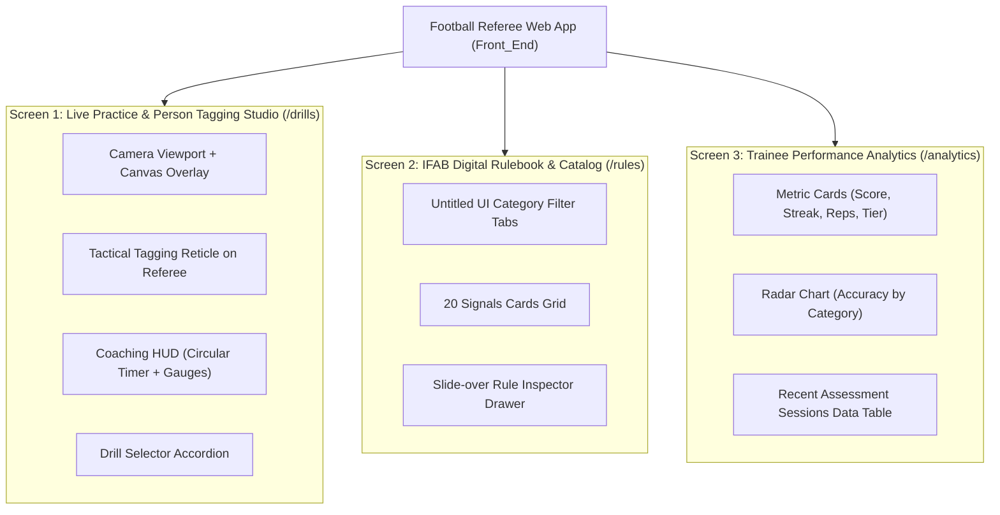

# Football Referee Assistant - UI/UX Design Specification
## Untitled UI React Components & Figcraft Architecture

เอกสารข้อกำหนดการออกแบบ UI/UX (Design Specification) สำหรับระบบ **Football Referee Signal Recognition & Training Assistant** โดยประยุกต์ใช้ดีไซน์ซิสเต็มและคอมโพเนนต์ระดับพรีเมียมจาก **Untitled UI React** (https://www.untitledui.com/react/components) เพื่อใช้เป็นพิมพ์เขียวสำหรับการออกแบบใน **Figcraft / Figma** และการพัฒนาส่วนหน้า (Front_End)

---

## 1. Design Vision & Foundations

### 1.1 Aesthetic & Theme Strategy: Adaptive Dual Theme
ระบบรองรับ **2 โหมดการแสดงผล (Adaptive Dual Theme)** เพื่อตอบสนองต่อบริบทการใช้งานที่แตกต่างกัน:
1. **Pitch Dark Mode (โหมดมืดสำหรับฝึกซ้อมสด):**
   - ใช้งานในหน้า **Live Practice & Tagging Studio (`/drills`)**
   - พื้นหลัง `Slate 950 (#090D16)` และการ์ด `Slate 900 (#0F172A)` เพื่อลดแสงสะท้อนและขับเน้นการแสดงผลจากกล้อง Webcam, โครงกระดูก 17 จุด (COCO Keypoints), และ Ghost Target Guide
   - สี Accent: `Cyan 400 (#22D3EE)` สำหรับเป้าหมาย Tagging และ `Emerald 400 (#34D399)` สำหรับสถานะสำเร็จ
2. **Clean Minimalist Light Mode (โหมดสว่างสำหรับแดชบอร์ดและรายงาน):**
   - ใช้งานในหน้า **Analytics Dashboard (`/analytics`)** และ **IFAB Rulebook (`/rules`)**
   - ใช้โทนสีขาว-เทามาตรฐานของ Untitled UI (`Gray 50 (#F9FAFB)`, `White (#FFFFFF)`, `Gray 200 (#EAECF0)`) พร้อมตัวหนังสือสี `Gray 900 (#101828)` ช่วยให้อ่านสถิติ, ตารางผลประเมิน, และตัวเลขเรดาร์ชาร์ตได้อย่างสบายตา

### 1.2 Untitled UI Color Tokens & Typography
- **Primary Brand (Cyan/Teal):**
  - `primary-50`: `#F0FDFA`, `primary-500`: `#14B8A6`, `primary-700`: `#0F766E`
- **Success / Valid Signal (Emerald):**
  - `success-50`: `#ECFDF5`, `success-500`: `#10B981`, `success-700`: `#047857`
- **Warning / Angle Deviation (Amber):**
  - `warning-50`: `#FFFBEB`, `warning-500`: `#F59E0B`, `warning-700`: `#B45309`
- **Error / Foul Action (Rose/Red):**
  - `error-50`: `#FFF1F2`, `error-500`: `#F43F5E`, `error-700`: `#BE123C`
- **Typography Scale (Inter):**
  - Display md: `36px` / Line height `44px` (Bold) - ชื่อระบบและตัวเลขคะแนนหลัก
  - Text lg: `18px` / Line height `28px` (Semibold) - หัวข้อการ์ดและหมวดหมู่กติกา
  - Text sm: `14px` / Line height `20px` (Medium/Regular) - เนื้อหาคำแนะนำการฝึกสอน
  - Text xs: `12px` / Line height `18px` (Medium/Mono) - องศาข้อต่อ, ค่า Latency, และป้าย Tag

### 1.3 Iconography Asset System: Google Font Icons (Material Symbols Outlined)
ระบบใช้ **Google Font Icons (Material Symbols Outlined)** เป็นมาตรฐานไอคอนเดี่ยวของทั้งแพลตฟอร์ม:
- **CDN:** `https://fonts.googleapis.com/css2?family=Material+Symbols+Outlined:opsz,wght,FILL,GRAD@20..48,100..700,0..1,-50..200`
- **React Component:** `<Google_Icon name="..." size={...} filled={...} />` ใน `Front_End/src/UI_Components/Common/Google_Icon.tsx`
- **Key Glyphs Mapping:**
  - วิดีโอกล้อง: `videocam`, `videocam_off`
  - การเล็งเป้าหมาย Tagging: `my_location`, `crop_free`, `how_to_reg`, `group`
  - สถิติและการประเมิน: `monitoring`, `bolt`, `emoji_events`, `check_circle`, `warning`
  - เมนูและการเรียนรู้: `search`, `menu_book`, `quiz`, `schedule`, `layers`, `flip`, `refresh`

---

## 2. Core Screens & Component Architecture in Figcraft

---

## 3. Screen 1: Live Practice & Person Tagging Studio (`/drills`)

### 3.1 Layout & Hierarchy (Desktop & Tablet)
- **Top Header Bar (Untitled UI Page Header):**
  - โลโก้และชื่อระบบ `⚽ Football Referee AI Assistant`
  - Breadcrumbs: `หน้าหลัก / แบบฝึกหัดสด / ฟรีคิกทางอ้อม`
  - Status Pill: 🟢 `Microservices Online (30+ FPS)`
  - Theme Switcher Toggle: 🌙 Dark / ☀️ Light

- **Main Camera & Viewport Area (ซ้าย/บน - 7 คอลัมน์):**
  - ขนาดวิดีโอ 16:9 (640x440 / 1280x720 Responsive)
  - **Tactical Person Tagging Reticle:**
    - กรอบเล็งเป้าหมาย 4 มุมฉากสี Cyan บนตัวผู้ตัดสินพร้อมป้ายลอย `[🎯 TAGGED: REFEREE (98%)]`
    - หากมีบุคคลอื่นในกล้อง (เช่น ผู้เล่น/ผู้ช่วยผู้ตัดสิน) จะแสดงกรอบสีเทาเส้นประ `[👤 Player #10 - คลิกเพื่อ Tag]`
    - รองรับการคลิกบนหน้าจอวิดีโอเพื่อสลับเป้าหมาย Tagging ทันที
  - **Skeleton Overlay Layer (Canvas 60 FPS):**
    - เส้นกระดูก 17 จุดตามมาตรฐาน COCO พร้อมสีตามความมั่นใจ
    - Ghost Target Guideline: โครงกระดูกสีฟ้าโปร่งแสงซ้อนทับบอกท่าทางเป้าหมาย
    - Angle Badge Arcs: วงกลมแสดงองศาของข้อศอก (`176°`) และมุมยกแขน (`172°`)
  - **Floating Action Bar (Glassmorphic Island ด้านล่างวิดีโอ):**
    - ปุ่มควบคุมกล้อง (เปิด/ปิดกล้อง, สลับ Mirror View)
    - ปุ่ม Toggle แสดงผล (Ghost Guide, Angle Badges, กรอบ Tagging)
    - ปุ่ม Auto-Tag ผู้ตัดสินอัตโนมัติ

- **Right Sidebar (ขวา - 5 คอลัมน์):**
  - **Metric Card 1 - Circular Hold Timer (Untitled UI Progress Circle):**
    - วงล้อ SVG นับถอยหลังระยะเวลา Hold (เช่น `1.2s / 1.5s`)
    - ตัวเลขคะแนนความถูกต้องตัวใหญ่ `94 / 100` (ตัวอักษรสีเขียวมรกต)
  - **Dynamic Live Coaching Toast:**
    - กล่องข้อความแจ้งเตือนคำแนะนำสด เปลี่ยนสีและไอคอนตามสถานะ:
      - 🟢 *สำเร็จ:* "ยอดเยี่ยมมาก! การให้สัญญาณถูกต้องตามกติกา IFAB"
      - 🟡 *แนะนำ:* "ยกแขนขวาขึ้นอีก 15° ให้ตรงตามมาตรฐาน"
      - 🔴 *ผิดกติกา:* "งอข้อศอกมากเกินไป กรุณายืดแขนให้ตรง"
  - **Joint Angle Linear Progress Gauges:**
    - แถบเกจวัดองศาการยกแขนเทียบกับเกณฑ์ผ่านขั้นต่ำ
    - แถบเกจวัดความเหยียดตรงของข้อศอกเทียบกับ 180°
  - **Drill Selector Accordion:**
    - รายการแบบฝึกหัด 20 ท่าทาง พร้อมปุ่มค้นหาและฟิลเตอร์แยกหมวดหมู่

---

## 4. Screen 2: IFAB Digital Rulebook & Signals Catalog (`/rules`)

### 4.1 Layout & Components
- **Header & Search Controls:**
  - แถบหัวข้อ Untitled UI Header: `คลังกติกาสัญญาณผู้ตัดสิน 20 ท่าทาง (IFAB Laws of the Game)`
  - ช่องค้นหา (Search Input) พร้อมไอคอนแว่นขยาย และ Dropdown ตัวกรองตามกติกา (Law 5, Law 11, Law 12, Law 13)
  - แท็บหมวดหมู่ (Untitled UI Segmented Controls/Tabs):
    - `ทั้งหมด (20)`, `ลูกตั้งเตะ (Restarts)`, `การทำฟาวล์ (Fouls)`, `การควบคุมเกม`, `การล้ำหน้า (Offside)`

- **20 Signals Card Grid (3 คอลัมน์):**
  - การ์ดแบบ Elevated Card พร้อม Border Glow เมื่อ Hover:
    - ส่วนหัว: ชื่อภาษาไทย (`ฟรีคิกทางตรง`) + ชื่อภาษาอังกฤษ (`Direct_Free_Kick`)
    - ป้าย Badges: `Law 13 - Free Kicks`, `แขนข้างใดข้างหนึ่ง (Either Arm)`
    - ตัวบ่งชี้มุมมาตรฐาน: `องศาการยกแขน: 90°`, `ความตรงของศอก: 170°+`, `เวลา Hold: 1.2s`
    - ข้อความสรุปกติกาและข้อควรระวัง
    - ปุ่ม Action: `🎯 เริ่มฝึกซ้อมท่านี้` (กดแล้ว Jump ไปหน้า `/drills` พร้อมโหลดท่านี้ทันที)

- **Slide-over Rule Inspector Drawer (Untitled UI Slide-over):**
  - เมื่อคลิกดูรายละเอียดเพิ่มเติมบนการ์ด หน้าต่าง Drawer จะเลื่อนออกมาจากฝั่งขวา:
    - รูปภาพประกอบท่าทางทางการจากคู่มือ IFAB
    - แผนภาพเวกเตอร์ข้อต่อ 17 จุด และช่วงองศาที่ยอมรับได้ (Tolerance Range)
    - รายการข้อผิดพลาดที่พบบ่อย (Common Mistakes to Avoid) เช่น แขนตกเร็วเกินไป, สะบัดแขน

---

## 5. Screen 3: Trainee Performance Analytics Dashboard (`/analytics`)

### 5.1 Metrics & Reporting Cards
- **Top Row - 4 Untitled UI Metric Cards:**
  1. **Overall Posture Accuracy:** `88.4%` (แสดง Badge แนวโน้ม `+4.2% vs สัปดาห์ก่อน` สีเขียว)
  2. **Total Drills Completed:** `142 ครั้ง` (สำเร็จตามเกณฑ์ 128 ครั้ง)
  3. **Current Success Streak:** `12 ครั้งติดต่อกัน` (พร้อมไอคอนถ้วยรางวัล)
  4. **Officiating Readiness Level:** `ระดับ 2 (ผู้ตัดสินระดับชาติขั้นต้น)`

- **Middle Row - Charts & Visualization:**
  - **Left (6 คอลัมน์): Radar Chart (เรดาร์ชาร์ตความแม่นยำรายหมวด):**
    - กราฟใยแมงมุมประเมิน 4 มิติ: ลูกตั้งเตะ (92%), การทำฟาวล์ (85%), การให้ได้เปรียบ (72%), การล้ำหน้า (91%)
    - แสดงไฮไลต์จุดอ่อน: *"หมวดการให้สัญญาณได้เปรียบ (Play On) ควรฝึกกางแขนให้กว้างขึ้น"*
  - **Right (6 คอลัมน์): Historical Performance Line Chart:**
    - กราฟเส้นแสดงพัฒนาการคะแนนย้อนหลัง 30 วัน พร้อมเส้นค่าเฉลี่ยมาตรฐาน IFAB Target (80 คะแนน)

- **Bottom Row - Recent Assessment Sessions (Untitled UI Data Table):**
  - ตารางประวัติการฝึกซ้อมและตรวจคลิปแมตช์:
    - คอลัมน์: รหัสเซสชัน, วันที่-เวลา, ชื่อการฝึกซ้อม, จำนวนท่าทาง, คะแนนเฉลี่ย, สถานะ (Badge: Excellent / Needs Review), ปุ่มดาวน์โหลดรายงาน PDF

---

## 6. Untitled UI React Component Mapping Matrix

| ฟังก์ชันในระบบของเรา | Untitled UI React Component | คุณลักษณะเฉพาะ (Variants & Props) |
|---|---|---|
| **คะแนน Posture Score** | `MetricCard` / `StatCard` | `size="lg"`, `trend="+4.2%"`, `trendDirection="up"` |
| **ตัวนับเวลา Hold Countdown** | `ProgressCircle` / `ProgressRing` | `size="xl"`, `color="emerald"`, `strokeWidth={6}` |
| **เกจวัดองศาข้อต่อ** | `ProgressBar` | `color="cyan"`, `labelPosition="top"`, `showValue={true}` |
| **ป้ายคำแนะนำสด (Coaching Tip)** | `Alert` / `ToastBanner` | `variant="subtle"`, `colorScheme="cyan/emerald/amber"` |
| **ป้ายกำกับกฎและสถานะ** | `Badge` | `size="sm"`, `variant="outline"`, `color="cyan/slate/emerald"` |
| **ปุ่มควบคุมกล้องและโหมด** | `Button` / `ButtonGroup` | `variant="secondary-gray"`, `size="sm"`, `iconOnly={true}` |
| **แท็บเลือกหมวดหมู่สัญญาณ** | `Tabs` / `SegmentedControl` | `variant="underline"`, `size="sm"`, `fullWidth={false}` |
| **หน้าต่างดูข้อมูลกติกา IFAB** | `Slideover` / `Drawer` | `size="md"`, `position="right"`, `overlay={true}` |
| **หน้าต่างตรวจเช็คสถานะระบบ** | `Modal` | `size="sm"`, `title="Microservices Health Monitor"` |
| **ตารางประวัติผลการประเมิน** | `Table` | `striped={false}`, `hoverable={true}`, `compact={true}` |

---

## 7. Next Steps for Implementation

1. **Review & Approval:** ยืนยันสเปกการออกแบบนี้เพื่อใช้เป็นเกณฑ์มาตรฐานใน Figcraft และการพัฒนาโค้ด
2. **Figcraft / UI Prototyping:** ออกแบบหน้าจอทั้ง 3 ส่วนใน Figcraft ตาม Token และโครงสร้างที่ระบุไว้
3. **Frontend Code Implementation (Task 4 - 6):** พัฒนาหน้าจอ `/drills`, `/assessment`, `/rules`, และ `/analytics` ใน `Front_End/` ให้ตรงตาม Untitled UI Design System
